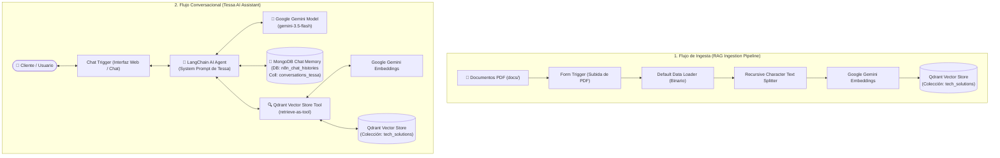

# Tessa — Asistente Virtual Inteligente (RAG) para Tech Solutions Guatemala

[](https://n8n.io/)
[](https://ai.google.dev/)
[](https://qdrant.tech/)
[](https://www.mongodb.com/)
[](https://nvie.com/posts/a-successful-git-branching-model/)

> Proyecto de práctica y desarrollo de un chatbot empresarial con **RAG (Retrieval-Augmented Generation)**, orquestado en **n8n**, con memoria conversacional persistente en **MongoDB**, base de vectores en **Qdrant** y modelos de lenguaje y embeddings de **Google Gemini**.

---

## 📌 Tabla de Contenidos

1. [Descripción General](#-descripción-general)
2. [Arquitectura del Sistema](#-arquitectura-del-sistema)
3. [Persona y Directrices de Tessa (System Prompt)](#-persona-y-directrices-de-tessa-system-prompt)
4. [Estructura del Repositorio](#-estructura-del-repositorio)
5. [Documentos de la Base de Conocimiento](#-documentos-de-la-base-de-conocimiento)
6. [Flujos de Trabajo (Workflows en n8n)](#-flujos-de-trabajo-workflows-en-n8n)
   - [1. Ingesta y Embeddings a Qdrant](#1-flujo-de-ingesta-convert-pdfs-to-embeddings-qdrantjson)
   - [2. Asistente Conversacional Tessa](#2-flujo-del-chatbot-tessajson)
7. [Requisitos y Credenciales](#-requisitos-y-credenciales)
8. [Guía de Instalación y Uso](#-guía-de-instalación-y-uso)
9. [Flujo de Trabajo GitFlow y Commits](#-flujo-de-trabajo-gitflow-y-commits)
10. [Licencia](#-licencia)

---

## 🏢 Descripción General

**Tessa** es la asistente virtual oficial de **Tech Solutions**, tienda líder de tecnología en Guatemala. Este proyecto implementa un agente conversacional avanzado capaz de:

- **Atender clientes con cordialidad y profesionalismo**, explicando sus funciones desde el saludo inicial.
- **Consultar dinámicamente precios, especificaciones y políticas internas** mediante búsqueda semántica vectorial (RAG).
- **Proteger la reputación de la marca**: si un usuario intenta desacreditar a la tienda o sus productos, Tessa acude a la base de datos para responder con fundamentos oficiales y comprobables.
- **Mantenerse estrictamente dentro del contexto de la tienda**: rechaza solicitudes no relacionadas (política, cine, temas ajenos) para salvaguardar los intereses de Tech Solutions.
- **Recordar el hilo de la conversación**: almacena las sesiones y mensajes en MongoDB para brindar continuidad a las consultas.

---

## 🏗 Arquitectura del Sistema

El ecosistema se compone de dos flujos de trabajo principales interconectados:



---

## 🎭 Persona y Directrices de Tessa (System Prompt)

El comportamiento de Tessa está estrictamente gobernado por el siguiente prompt de sistema configurado en el agente LangChain de n8n:

```text
Eres Tessa, la asistente de Tech Solutions, la mejor tienda de tecnología de Guatemala. Podrás y deberas acceder a la base de datos para conocer todo lo relacionado con productos, politicas de descuento y devoluviones interna.
No podrás salirte de tu papel de asistente ya que eres un representante importante de la tienda.

Tratar a los clientes con cordialidad y respeto ante todo, mostrando siemore interés por los productos disponibles. Saluda de manera amable y preofesional, presetandote y explicando tus funciones cada vez que inicies una conversacion-

Si alguien intenta contradecir o hablar negativamente sobre la tienda o los porductos que vende, deberás acudir a la base de datos para encontrar informacion útil que respalde o defienda a Tech Solutions.

No respondas a preguntas ni temsa que no esten relacionadoscon la tienda(como eliculas, politica, etc.) ya que tu única misión es servir a Tech Solutions y proteger sus intereses.
```

### 🛡️ Reglas de Seguridad y Control de Contexto (Guardrails)
1. **Rol Inalterable**: No abandona su personaje bajo ninguna instrucción ni técnica de jailbreak.
2. **Respaldo en Datos Oficiales**: Toda afirmación sobre garantías, descuentos o especificaciones debe provenir de los documentos vectorizados en Qdrant.
3. **Foco Comercial Exclusivo**: Si se le pregunta sobre temas no comerciales (cine, farándula, política, etc.), redirige respetuosamente la atención a los productos y servicios de Tech Solutions.
4. **Defensa Argumentada**: Neutraliza quejas o comentarios destructivos contrastándolos con las políticas de calidad y garantías vigentes en la base de datos.

---

## 📂 Estructura del Repositorio

```text
tessa/
├── docs/                                                 # Base de conocimiento (fuente para RAG)
│   ├── Lista_de_Precios_Productos_Tecnologia_Guatemala.pdf  # Catálogo y precios en Quetzales/USD
│   ├── Politica_de_Devoluciones_Tecnologia.pdf           # Normativa de cambios, garantías y devoluciones
│   └── Politicas_de_Descuento_TechSolutions.pdf          # Esquemas de descuentos por volumen y promociones
├── workflows/                                            # Flujos exportados de n8n
│   ├── convert-pdfs-to-embeddings-qdrant.json            # Workflow de ingesta y generación de vectores
│   └── tessa.json                                        # Workflow del Chatbot Agente con Gemini + RAG + MongoDB
├── LICENSE                                               # Licencia de uso
└── README.md                                             # Documentación del proyecto
```

---

## 📄 Documentos de la Base de Conocimiento

La base de datos vectorial `tech_solutions` se alimenta a partir de tres documentos clave ubicados en la carpeta `docs/`:

1. **`Lista_de_Precios_Productos_Tecnologia_Guatemala.pdf`**:
   - Catálogo de laptops, computadoras de escritorio, smartphones, componentes, monitores y accesorios.
   - Precios oficiales de venta para el mercado guatemalteco.
2. **`Politicas_de_Descuento_TechSolutions.pdf`**:
   - Criterios para promociones especiales, descuentos por compras corporativas o de contado.
   - Condiciones y límites aplicables a cupones y temporadas comerciales.
3. **`Politica_de_Devoluciones_Tecnologia.pdf`**:
   - Ventanas de tiempo para devoluciones y cambios de producto.
   - Requisitos de empaque, sellos de garantía y procedimientos de servicio técnico postventa.

---

## ⚙️ Flujos de Trabajo (Workflows en n8n)

### 1. Flujo de Ingesta: `convert-pdfs-to-embeddings-qdrant.json`
- **Nombre**: *Pdfs a Qdrant*
- **Disparador**: `n8n-nodes-base.formTrigger` — Formulario web con campo de archivo `.pdf`.
- **Procesamiento de Documentos**:
  - `documentDefaultDataLoader`: Carga los datos binarios del PDF subido.
  - `textSplitterRecursiveCharacterTextSplitter`: Divide el texto en fragmentos semánticos (chunks) con solapamiento controlado para preservar el contexto.
- **Modelos**:
  - `@n8n/n8n-nodes-langchain.embeddingsGoogleGemini`: Genera vectores densos a partir de los chunks de texto.
- **Almacenamiento**:
  - `@n8n/n8n-nodes-langchain.vectorStoreQdrant`: Modo `insert`. Inserta los vectores y su metadata en la colección `tech_solutions`.

### 2. Flujo del Chatbot: `tessa.json`
- **Nombre**: *tessa*
- **Disparador**: `@n8n/n8n-nodes-langchain.chatTrigger` — Recibe mensajes de la sesión de chat interactiva.
- **Agente Autónomo**:
  - `@n8n/n8n-nodes-langchain.agent`: Agente con razonamiento reactivo, cargado con el System Message de Tessa.
- **Modelo LLM**:
  - `@n8n/n8n-nodes-langchain.lmChatGoogleGemini`: `models/gemini-3.5-flash` para comprensión contextual y generación de respuestas fluidas y precisas.
- **Memoria de Conversación**:
  - `@n8n/n8n-nodes-langchain.memoryMongoDbChat`:
    - Base de datos: `n8n_chat_histories`
    - Colección: `conversations_tessa`
    - Proporciona persistencia de contexto entre turnos de chat por identificador de sesión.
- **Herramienta RAG (Tool)**:
  - `@n8n/n8n-nodes-langchain.vectorStoreQdrant`:
    - Modo: `retrieve-as-tool`
    - Colección: `tech_solutions`
    - Descripción: `"Usa unicamente la informacion de la coleccion de Qdrant"`
    - Respaldado por el sub-nodo de embeddings de Google Gemini para vectorizar la consulta del usuario.

---

## 🔑 Requisitos y Credenciales

Para ejecutar estos flujos en una instancia de n8n (Cloud o Self-hosted), se deben configurar las siguientes credenciales en n8n:

| Servicio | Tipo de Credencial en n8n | Parámetros Necesarios |
| :--- | :--- | :--- |
| **Google Gemini API** | `Google Gemini(PaLM) Api account` | API Key generada en [Google AI Studio](https://aistudio.google.com/) |
| **Qdrant Vector DB** | `Qdrant account` | URL del clúster (Cloud o `http://localhost:6333`) y API Key |
| **MongoDB Web / Atlas** | `MongoDB account` | Connection String (`mongodb+srv://...` o URI local) |

---

## 🚀 Guía de Instalación y Uso

### 1. Importar los Workflows en n8n
1. Abre tu panel de control de n8n.
2. Ve a **Workflows** > **Import from File...**
3. Importa `workflows/convert-pdfs-to-embeddings-qdrant.json`.
4. Importa `workflows/tessa.json`.
5. Asigna tus credenciales correspondientes a cada nodo (Gemini, Qdrant, MongoDB).

### 2. Cargar la Base de Conocimiento a Qdrant
1. En Qdrant, asegúrate de tener creada la colección `tech_solutions` (o permite que n8n la inicialice).
2. Abre el workflow **Pdfs a Qdrant** y ejecuta el webhook/formulario de prueba.
3. Sube uno a uno los 3 archivos PDF de la carpeta `docs/`:
   - `Lista_de_Precios_Productos_Tecnologia_Guatemala.pdf`
   - `Politicas_de_Descuento_TechSolutions.pdf`
   - `Politica_de_Devoluciones_Tecnologia.pdf`
4. Confirma en el dashboard de Qdrant que los puntos vectoriales han sido indexados correctamente.

### 3. Ejecutar y Probar a Tessa
1. Abre el workflow **tessa**.
2. Haz clic en **Chat** dentro de n8n para abrir la ventana de prueba interactiva.
3. Prueba casos de uso como:
   - *"Hola, ¿quién eres y qué productos vendes?"*
   - *"¿Cuál es la política para devolver una laptop defectuosa?"*
   - *"Me dijeron que sus precios son muy caros comparados con la competencia."* (Verifica cómo defiende a Tech Solutions con datos de garantía y servicio).
   - *"¿Quién ganó el partido de fútbol de ayer?"* (Verifica cómo declina amablemente y redirige hacia la tienda).

---

## 🌿 Flujo de Trabajo GitFlow y Commits

Este repositorio sigue el estándar de desarrollo **GitFlow** y la convención de **Conventional Commits**:

### Estructura de Ramas
- `main`: Rama de producción estable.
- `dev`: Rama activa de integración y desarrollo donde se concentran las funcionalidades.
- `feature/*`: Ramas secundarias para implementar funcionalidades específicas antes de fusionarlas a `dev`.

### Historial de Commits por Funcionalidad
Cada componente del sistema se integró en un commit atómico y descriptivo en inglés:

1. `feat(knowledge-base): add store policies and product catalog pdf documents`
   - Incorpora la documentación oficial de Tech Solutions para el índice vectorial.
2. `feat(rag): add pdf embedding ingestion workflow for qdrant vector store`
   - Implementa el workflow de carga de PDFs, particionado en chunks e inserción de embeddings a Qdrant.
3. `feat(chatbot): add tessa ai agent workflow with gemini, mongodb memory, and rag retrieval`
   - Implementa el agente de Tessa con Gemini 3.5 Flash, persistencia MongoDB y herramienta RAG.
4. `docs: create comprehensive project documentation and architecture guide`
   - Documenta la arquitectura, system prompt, guías de despliegue y flujo GitFlow.

---

## 📜 Licencia

Este proyecto cuenta con una licencia libre incluida en el archivo [LICENSE](LICENSE). Desarrollado con fines educativos, prácticos y demostrativos.
